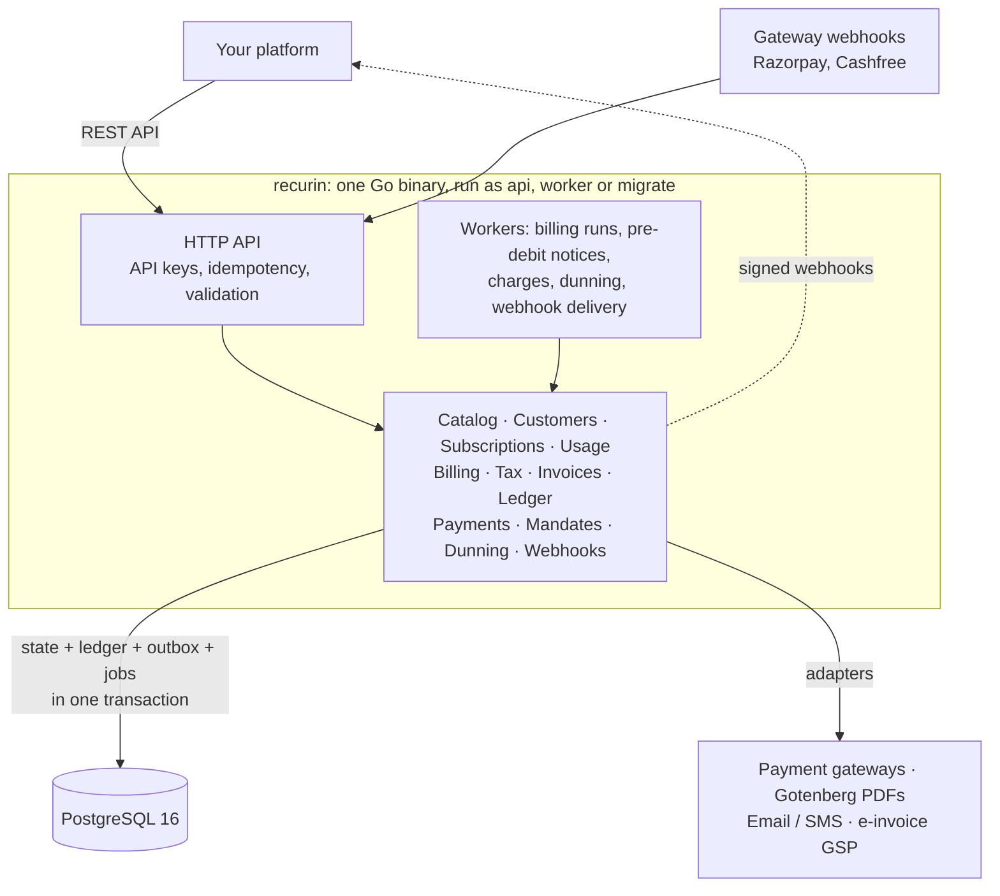

# recurin

**Self-hostable subscription billing for India.** UPI AutoPay and e-NACH mandates, RBI pre-debit notices, GST-correct invoices and a double-entry ledger, in one Go binary next to your Postgres.

[](LICENSE)


> **Status: pre-alpha, being built in the open.** Nothing here is ready for production yet. Track progress on the [project board](https://github.com/users/annmary-ann/projects/9). The first public release (v0.1, the full Indian renewal loop) is planned for March 2027.

## What it does

recurin runs beside your product. You call a REST API, and it handles the billing work you would otherwise build yourself:

- **Plans and pricing:** flat, per-seat, tiered, volume, usage-based, add-ons, coupons and free trials.
- **Subscription lifecycle:** upgrades and downgrades with exact proration, pauses, cancellations and scheduled changes.
- **Indian recurring payments:** UPI AutoPay, e-NACH and card e-mandates through Razorpay (Cashfree next), with the 24-hour pre-debit notice and mandate limits built in.
- **GST invoicing:** CGST + SGST or IGST from the place of supply, gap-free invoice numbers per financial year, credit notes, and IRN e-invoicing as a plugin.
- **Dunning:** retries with configurable schedules and a link for customers to fix their mandate.
- **Webhooks and test clocks:** signed, retried events for your app, and test clocks that fast-forward months of billing in seconds.

## Why India-first

Open-source billing engines are built around card-on-file payments, where you can charge a saved card whenever you like. Indian recurring payments do not work that way:

| Indian rule | What it changes in a billing engine |
| --- | --- |
| The customer must get a pre-debit notice before each auto-debit | Invoices are created *before* the renewal date, not at it |
| Debits above a limit need the customer to approve them again | Some renewals become payment links instead of auto-debits |
| Mandates carry a maximum amount and an expiry, and customers can cancel them from their UPI app | Every charge is checked against the mandate, and a revoked mandate is a normal event |
| GST invoices need specific fields and a tax split based on the customer's state | Tax is part of the core data model, not an add-on |

recurin is designed around these rules from the first line of code.

## Design principles

1. **Never create or lose a paisa.** Money is stored as integer paise, every movement posts a balanced double-entry journal entry, and property tests check these invariants.
2. **Exactly-once where it matters.** Idempotency keys, a transactional outbox and database constraints stop double invoices and double charges, even when workers crash or retry.
3. **Boring infrastructure.** One Go binary and PostgreSQL. Postgres is also the job queue and the outbox. No Kafka, no Redis.
4. **Customise without forking.** Provider interfaces for gateways, tax and notifications; overridable invoice templates; webhooks and metadata on every object.
5. **Decisions are written down.** Architecture decision records live in [`docs/adr`](docs/adr).

## Architecture



Each module owns its tables and talks to the others only through Go interfaces; CI enforces the boundaries.

## Tech stack

Go 1.27 · PostgreSQL 16 · pgx + sqlc · goose · River (Postgres job queue) · OpenAPI 3.1 with oapi-codegen · OpenTelemetry · Gotenberg · Docker Compose and Helm · React admin console

## Quickstart

Coming with v0.1. The plan is one command:

```sh
docker compose up
```

## Roadmap

| Milestone | Target | Outcome |
| --- | --- | --- |
| M0 Foundations | Dec 2026 | Toolchain, CI, dev stack, ADRs, money, clock and ID primitives |
| M1 Catalog, customers, tax, ledger | Jan 2027 | Plans, customers, GST engine, double-entry ledger |
| M2 Subscriptions and invoicing | Feb 2027 | Renewals, proration, GST invoices, test clocks |
| M3 India payments → **v0.1** | Mar 2027 | Mandate → pre-debit notice → charge → paid, with dunning and webhooks |
| M4 Documents, refunds, reconciliation | Mar 2027 | Invoice PDFs, credit notes, refunds, settlement reconciliation |
| M5 Pricing breadth | Apr 2027 | Usage-based pricing, tiers, coupons, add-ons, second gateway |
| M6 → **v1.0** | May 2027 | Admin console, SDKs, Helm chart, docs site, load-test report |

## Contributing

Issues and pull requests are welcome. Start with [CONTRIBUTING.md](CONTRIBUTING.md). To report a security problem, follow [SECURITY.md](SECURITY.md) rather than opening a public issue.

## License

[Apache License 2.0](LICENSE). recurin is not affiliated with RBI, NPCI, GSTN or any payment gateway. It helps you follow their rules but is not legal or tax advice.
