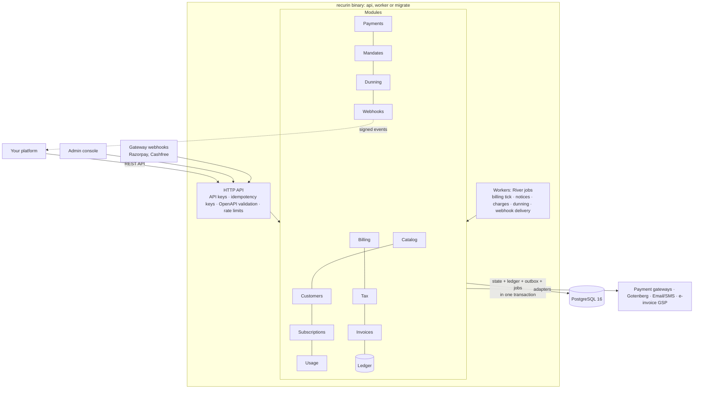
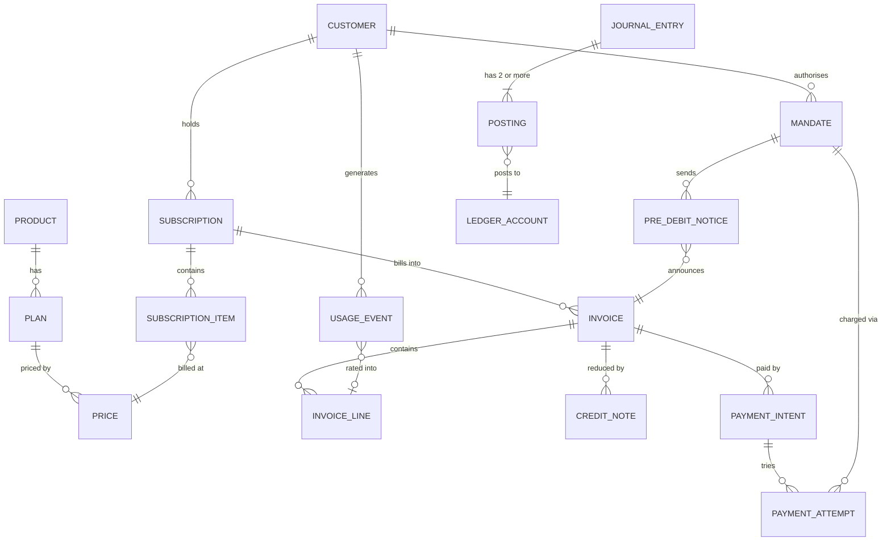
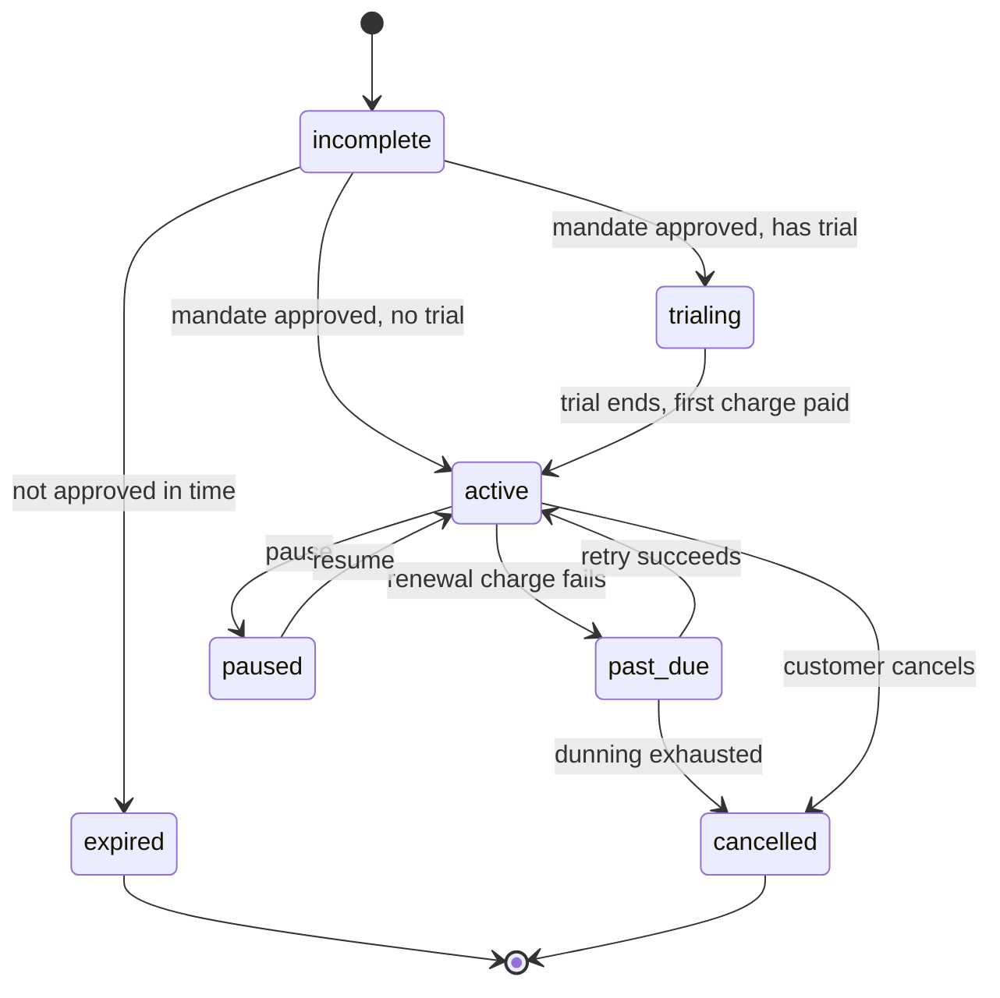

# Architecture

recurin is a **modular monolith**: one Go binary and one PostgreSQL database, split inside into modules with hard boundaries. The reasoning behind each major choice is in the [architecture decision records](adr/README.md).

## Components

### Module rules

- Each module lives in `internal/<module>` and **owns its tables**. Other modules call its Go interface; they never query its tables. CI enforces this (#13).
- Modules react to each other through **domain events** (`subscription.renewed`, `invoice.finalized`, `payment.succeeded`) written to an outbox in the same transaction as the change ([ADR 0002](adr/0002-postgres-as-store-queue-and-outbox.md)).
- Only `payments` talks to gateways, only `tax` knows GST rules, and only `ledger` writes journal entries.
- `internal/api` is the HTTP layer: routing, middleware and server lifecycle. It translates between HTTP and modules and holds no business logic.
- `internal/platform` holds shared building blocks: money, clock, IDs, idempotency, the outbox and authentication.

### Roles

| Role | Command | Runs | Scales by |
| --- | --- | --- | --- |
| api | `recurin api` | REST API, gateway webhook receivers, health endpoints | Stateless replicas behind a load balancer |
| worker | `recurin worker` | River jobs: billing tick, charges, pre-debit notices, dunning, webhook delivery, PDF rendering | More replicas; jobs are claimed with `FOR UPDATE SKIP LOCKED` |
| migrate | `recurin migrate` | Schema migrations, once per release | n/a |

### Request path

A call such as `POST /v1/subscriptions` passes authentication, then the idempotency check (same key and same body returns the stored response), then the module's service. The service opens one transaction, changes state, writes ledger entries and outbox events, enqueues follow-up jobs, and commits. Nothing reaches the outside world before that commit.

### Time-driven work

A periodic **billing tick** runs every minute. It selects subscriptions with `next_billing_at <= now()` in batches with `SKIP LOCKED` and enqueues one job per subscription. Each job is idempotent on `(subscription_id, period_start)`, so a crash or a duplicate tick never bills twice. Renewals are billed ahead of the charge so the pre-debit notice can go out first ([ADR 0006](adr/0006-bill-ahead-of-the-charge.md)).

## Data model

The database refuses bad money states itself: a double invoice, an unbalanced journal entry or a charge above a mandate cap fails a constraint, not only a code path.

Invoices, credit notes, payments and refunds each post exactly one balanced journal entry. Customer balances are sums of postings, never a column someone updates.

### Conventions on every table

The full rules, and how migrations, queries and database tests work, are in [database.md](database.md).

- **IDs:** type-prefixed UUIDv7 (`cus_`, `sub_`, `inv_`, `pay_`), stored as native `uuid` ([ADR 0005](adr/0005-type-prefixed-uuidv7-ids.md)).
- **Money:** `amount_paise bigint` + `currency char(3)`; rates in basis points ([ADR 0003](adr/0003-money-as-int64-paise.md)).
- **Time:** `timestamptz` in UTC; invoice dates and GST periods computed in `Asia/Kolkata`.
- **Concurrency:** `version int` for optimistic locking on subscriptions, invoices and mandates.
- **Tenancy:** `account_id` on every row, so Postgres row-level security can enable multi-tenancy later.
- **Extensibility:** `metadata jsonb` on customer-facing objects; history in append-only `*_events` tables.

### Tables by module

| Module | Tables | Rule the database enforces |
| --- | --- | --- |
| Catalog | `products`, `plans`, `prices`, `addons`, `coupons`, `coupon_redemptions` | A used price is immutable; changes create a new version |
| Customers | `customers`, `addresses` | GSTIN format check; state code required for place of supply |
| Subscriptions | `subscriptions`, `subscription_items`, `subscription_schedules`, `subscription_events` | Status limited to the state-machine values |
| Usage | `meters`, `usage_events`, `usage_aggregates` | `unique (account_id, event_id)` drops duplicate events |
| Billing / Invoices | `invoices`, `invoice_lines`, `credit_notes`, `credit_note_lines`, `invoice_sequences` | `unique (subscription_id, period_start)`; gap-free numbers per series and financial year |
| Tax | `tax_rates`, `seller_registrations` | Rates carry `effective_from`, so old invoices keep old rates |
| Ledger | `ledger_accounts`, `journal_entries`, `postings` | Postings of an entry sum to zero (deferred trigger); rows are insert-only |
| Payments / Mandates | `mandates`, `pre_debit_notices`, `payment_intents`, `payment_attempts`, `refunds` | `unique (gateway, gateway_ref)`; refunds never exceed the captured amount |
| Dunning | `dunning_policies`, `dunning_runs` | One open run per invoice |
| Platform | `api_keys`, `idempotency_keys`, `outbox_events`, `webhook_endpoints`, `webhook_deliveries`, `gateway_events`, `audit_log` | Inbound gateway events deduplicated on `(gateway, event_id)` |

## Subscription lifecycle

The state machine is one Go type with an explicit transition table. Any transition not in the table is rejected, and every accepted one writes a `subscription_events` row and an outbox event.

## Renewal with an Indian e-mandate

1. **Bill ahead.** At `period_end − lead_time` (default 48 h, per payment rail) the billing tick creates and finalises the renewal invoice, with GST and an invoice number.
2. **Notify.** The mandates module sends the pre-debit notice through the gateway and/or recurin's own email or SMS, and records `debit_after`.
3. **Charge.** At `max(period_end, debit_after)` a charge job creates a payment attempt against the mandate, after checking the mandate cap and the extra-authentication limit.
4. **Settle.** The gateway webhook (signature-verified, deduplicated) marks the attempt succeeded or failed. Success posts *receivable → cash clearing* to the ledger; failure hands the invoice to dunning.
5. **Advance.** The subscription moves to the next period and emits `invoice.paid` and `subscription.renewed`.

The India-specific rules this flow implements are listed with their sources in `docs/compliance.md` (#14).
